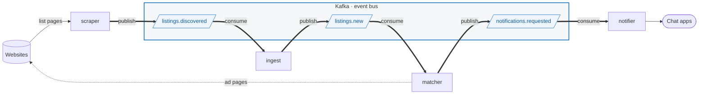
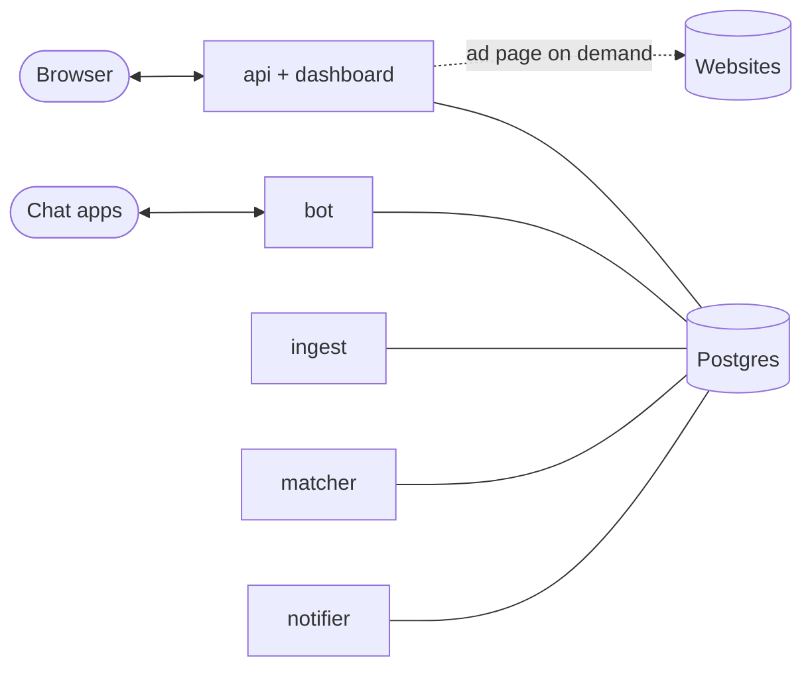
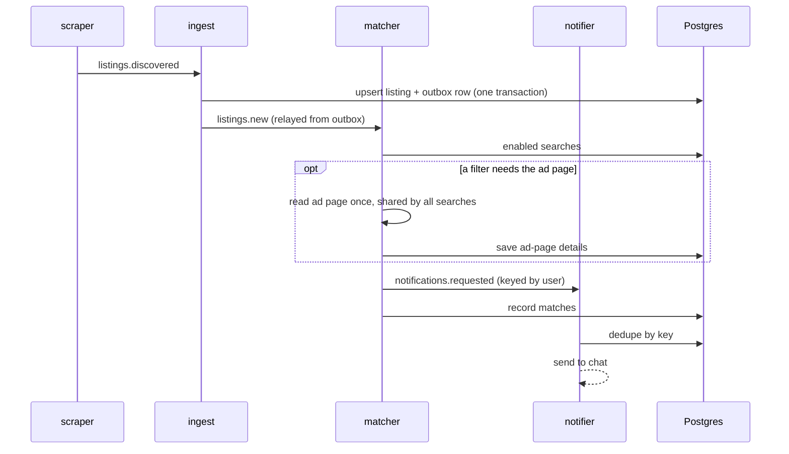
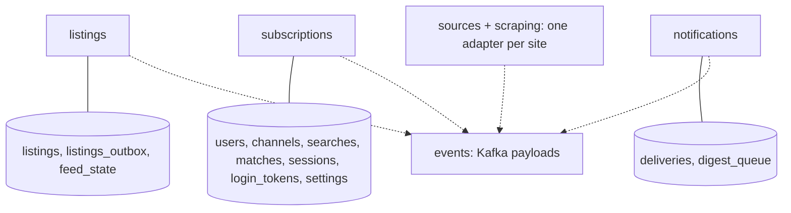
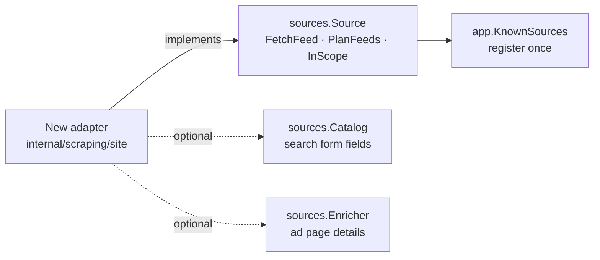

# Architecture

One Go module, six services (`cmd/*`), Kafka between them, one Postgres.
Each `internal/` slice owns its tables; slices share only `internal/events`.
Websites plug in as **source adapters** (`internal/sources` interface, one
package per site under `internal/scraping/`). Nothing else changes per site.

## Services

Around the bus: everything that talks to people, and the shared database.

| Service | Job |
|---|---|
| scraper | Polls the feeds searches need, through each site's adapter; publishes every ad seen |
| ingest | Stores ads; outboxes the new ones |
| matcher | Matches new ads to searches; reads the ad page only when a filter needs it |
| notifier | Delivers alerts, idempotent, with burst digests |
| bot | Chat commands: `/watch`, `/searches`, `/dashboard` |
| api | Dashboard and JSON API; search preview; admin overview |

## A new ad, end to end

## Slices and their tables

One Postgres database, one schema (`public`). Each slice owns its tables and
migrates them itself (`<slice>_migrations`); no slice queries another's tables,
except the admin overview, a read-only report across all of them.

## Adding a website

## Guarantees

- **No lost ads:** a listing and its outbox row commit together; Kafka keeps offsets per service.
- **No duplicate alerts:** the notifier dedupes by `search:source:ad`.
- **Polite scraping:** searches share feeds, requests are spaced, failures back off.
- **Details are kept:** ad-page facts live in `listings.details`, which scrapes don't overwrite.
